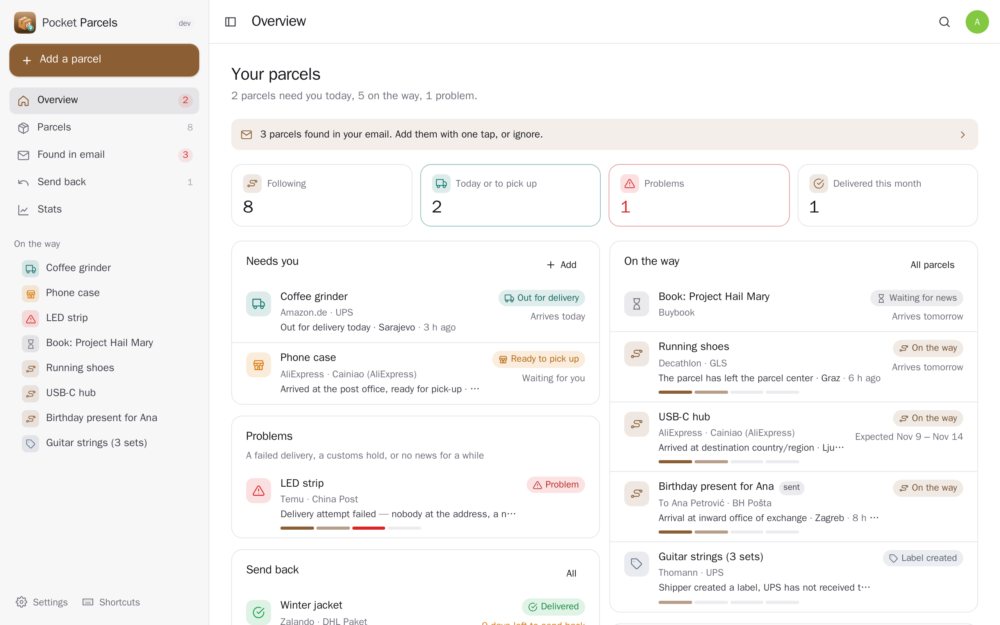
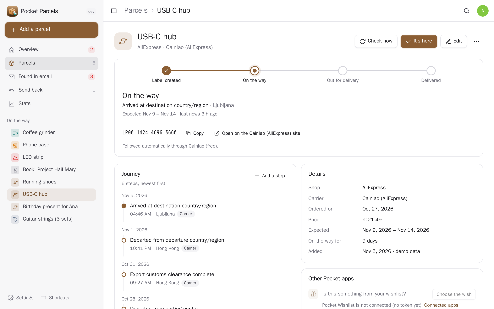
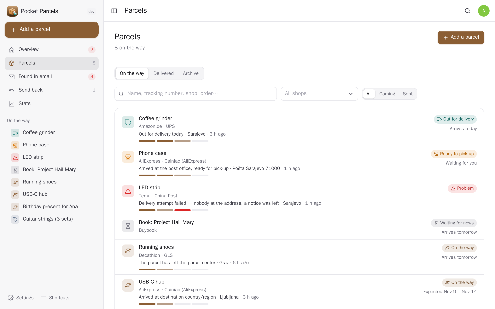
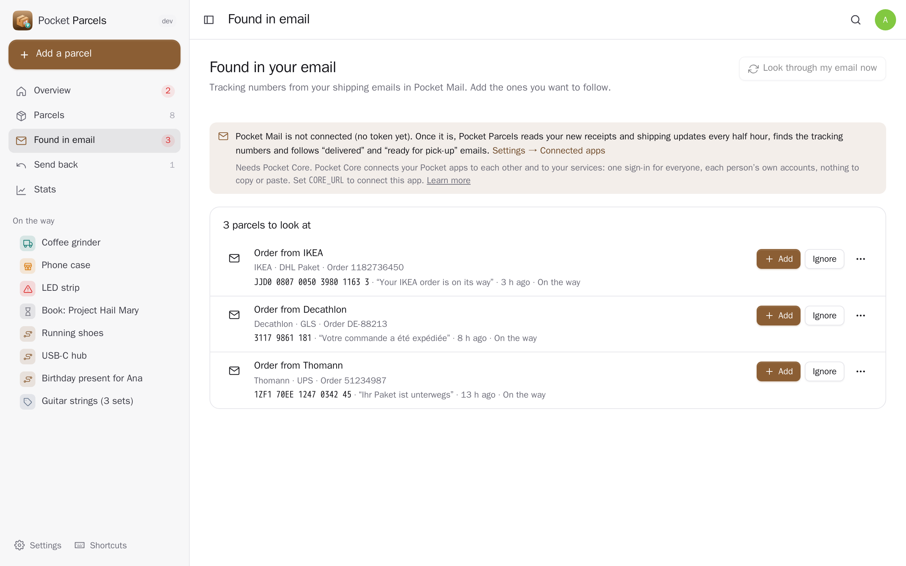
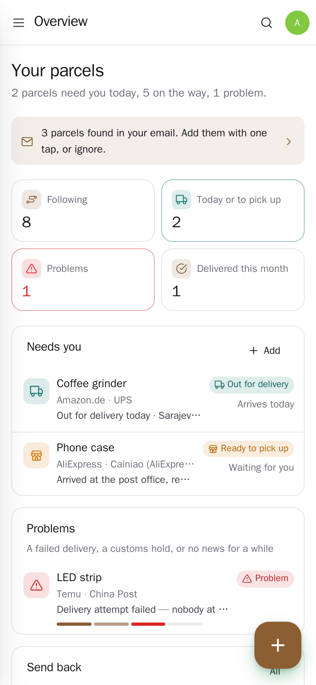

<p align="center"></p>
<h1 align="center">Pocket Parcels</h1>
<p align="center">Every parcel in one place, on your own server. Paste a tracking number — or let it find them in your email — and see where each parcel is, when it should arrive and what happened on the way, with a push when it is out for delivery, waiting at the post office or delivered. It remembers what you ordered, from where and what it cost, and the last day to send it back. AliExpress parcels are followed for free; with a 17TRACK key every carrier is. The wish you ordered is marked bought in Pocket Wishlist, the payment is linked in Pocket Money, what arrived goes on your shelves in Pocket Inventory, delivery days show up in Pocket Calendar and a parcel waiting at the post office becomes a task.<br>One Go binary, one SQLite file, one volume. Part of the Pocket apps; works on its own too.</p>
<p align="center">
  <a href="https://github.com/abjelosevic88/pocket-homelab-parcels/actions"></a>
  <a href="https://github.com/abjelosevic88/pocket-homelab-parcels/pkgs/container/pocket-homelab-parcels"></a>
  <a href="LICENSE"></a>
</p>

---

<p align="center"></p>

<table>
  <tr>
    <td width="50%"></td>
    <td width="50%"></td>
  </tr>
  <tr>
    <td align="center"><sub>One parcel: how far along it is, every step on the way, the order, the price and the return deadline.</sub></td>
    <td align="center"><sub>Everything on its way, what needs you first; delivered ones move to their own list.</sub></td>
  </tr>
  <tr>
    <td width="50%"></td>
    <td width="50%"></td>
  </tr>
  <tr>
    <td align="center"><sub>Shipping emails from Pocket Mail turn into parcels: one tap to follow, or added on their own.</sub></td>
    <td align="center"><sub>Made for the phone too: the + button adds a parcel from a pasted tracking number.</sub></td>
  </tr>
</table>

## What it does

- **Paste a number, that's it**: spaces and dashes are fine. It tells the carrier from the number (UPU numbers like `RR123456785CN` name their national post; UPS, Cainiao, DHL, Amazon, PostNL, YunExpress… by their shape), links to the carrier's own tracking page and warns you when you already follow it.
- **Followed for you**: AliExpress / Cainiao parcels (and Chinese, Hong Kong, Singapore post numbers) through Cainiao's public tracking, with no key; every other carrier with a 17TRACK API key of your own. Checks come round sooner when it matters: every half hour while out for delivery.
- **Where it is**: the steps on its way with places and times, a simple stage line (label created → on the way → out for delivery → delivered, or ready to pick up, problem, sent back), the expected day or days, how long it has been on the way.
- **Found in your email**: the receipts and shipping updates in Pocket Mail are read every half hour; tracking numbers become parcels to add with one tap (or added on their own if you like), and "delivered" or "ready for pick-up" emails go into the parcel's timeline. Patterns read the email first; your AI only reads the shipping emails they could not make sense of.
- **Pushes when it counts**: out for delivery, ready to pick up, delivered, a problem — and once a day the return deadlines coming up and parcels nobody has heard of for a while (Apprise, ntfy or a JSON webhook).
- **Returns**: the last day to send something back, a reminder three days and one day before, *Keep it* / *Send it back* / *Sent back*, and a task in Pocket Tasks to do it.
- **What it cost**: the price, customs and postage paid on top, parcels per month, how long each shop and carrier takes, what was spent.
- **Parcels you send**: to a contact, with the post office's number, followed the same way.
- **No number?** A sofa the shop delivers itself: give it a name and a day.
- **Everyone their own**: each person has their own parcels, settings, keys and connections; admins see no one else's.
- **Export and import** as JSON (idempotent), CSV, a whole-database backup for admins.

## Run it

```sh
docker run -d --name pocket-parcels -p 8080:8080 -v ./data:/data \
  -e BASE_URL=https://parcels.example.com -e SECURE_COOKIES=true \
  ghcr.io/abjelosevic88/pocket-homelab-parcels:latest
```

or `docker compose up -d` with [docker-compose.yml](docker-compose.yml). Open it, create the first account and paste a tracking number. To have every carrier followed, get an API key at [17TRACK](https://api.17track.net) and add it under Settings → Tracking (it is your own: each person adds theirs). All options: [docs/configuration.md](docs/configuration.md). API: [docs/api.md](docs/api.md).

## With Pocket Core

Set `CORE_URL` and `CORE_REGISTRATION_KEY` and Parcels joins the box: people sign in with Pocket Core, and through app links each person's parcels reach their own Pocket apps with nothing to paste:

| App | What Parcels does there | Scopes |
|---|---|---|
| Pocket Mail | reads new receipts and shipping updates for tracking numbers, and follows "delivered" emails | `mail:read` |
| Pocket Money | links an order to its payment (and fills in the price); books customs or postage paid on top as an expense | `accounts:read`, `transactions:read`, `transactions:write` |
| Pocket Wishlist | links a parcel to the wish it is and marks the wish bought | `wishes:read`, `wishes:write` |
| Pocket Inventory | puts what arrived on your shelves, by a tap or for every delivery | `items:read`, `items:write` |
| Pocket Calendar | expected delivery days and return deadlines as all-day events, moved when they change | `calendar:read`, `calendar:write` |
| Pocket Tasks | "Pick up …" when a parcel waits at the post office, "Send back …" before the deadline | `tasks:write` |
| Pocket Contacts | who you send a parcel to | `contacts:read` |
| Pocket Documents | the invoice, customs papers or return label kept with a parcel | `documents:read` |
| Pocket AI | reads the shipping emails patterns miss; the Ask button on every page | inference |

Other apps can read your parcels (`parcels:read`: Pocket AI's "what arrives today?" and the morning briefing, Pocket Day's journal) or add them for you (`parcels:write`: an order confirmation, a shipping email). Events on the bus: `parcels.added`, `parcels.status_changed`, `parcels.out_for_delivery`, `parcels.ready_for_pickup`, `parcels.delivered`, `parcels.problem`, `parcels.return_due`, `parcels.found_in_mail`. Without Core every connection can be made directly with a URL and a token; the Core-only choices stay visible, greyed out.

## Develop

```sh
make dev     # API on :8080 with demo data + Vite on :5173
make test    # go vet, go test, tsc
make         # web + binary
```

MIT licensed. Tracking information comes from the carriers through 17TRACK and Cainiao; Pocket Parcels is not affiliated with either.
